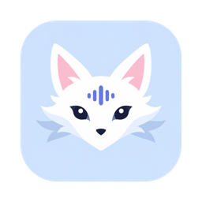
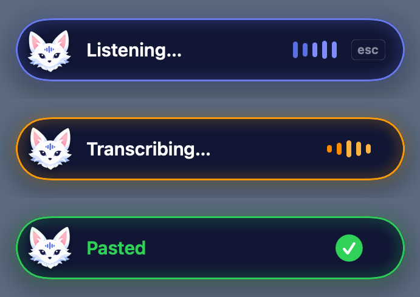

<p align="center">
  
</p>

<h1 align="center">Foxtation</h1>

<p align="center">
  Local voice dictation for macOS. Hold a key, speak, and a little fox types it for you.<br>
  Transcription runs on your Mac — no audio or telemetry ever leaves it.
</p>

<p align="center">
  <a href="https://foxtation.khaisa.studio">foxtation.khaisa.studio</a>
</p>

<p align="center">
  
</p>

---

## Features

- **Hold to talk** — hold right <kbd>⌥</kbd>, speak, release. The text lands in whatever field has focus: editors, terminals, browsers, chat apps.
- **Hands-free** — double-tap right <kbd>⌥</kbd> to keep listening, tap again to stop.
- **Fast, on-device Whisper** — `whisper-large-v3-turbo` on the Neural Engine via WhisperKit, transcribing while you speak: text is ready about half a second after you let go.
- **23 languages** — pick the ones you speak in **Settings › General**. Auto-detect only chooses among those, so a few seconds of Indonesian never come out as Malay or Tagalog, and two languages in one sentence stay mixed.
- **Stays out of the way** — a small pill at the bottom center of the screen, never steals focus, your clipboard is restored after pasting.
- **Your words, your way** — a personal dictionary (names, product terms, `btw → by the way` replacements per app), snippets you drop in by saying a cue, and a cleanup style per kind of app.
- **See your progress** — Home shows today's dictations; Insights shows speaking speed, time saved, fixes, apps and your streak. History stays on your Mac.

## Install

Requires macOS 14 or later on Apple silicon.

### Homebrew

```sh
brew install --cask khmuhtadin/tap/foxtation
```

### DMG

1. [Download Foxtation.dmg](https://github.com/khmuhtadin/foxtation/releases/latest/download/Foxtation.dmg) (the latest release) and drag **Foxtation** into **Applications**.
2. Foxtation isn't notarized by Apple yet, so the first launch is blocked. Open it once, then go to **System Settings › Privacy & Security** and click **Open Anyway** — or run:

   ```sh
   xattr -dr com.apple.quarantine /Applications/Foxtation.app
   ```

The default engine needs nothing else. Only the optional MLX engine needs [uv](https://docs.astral.sh/uv/) (`brew install uv`).

## First run

1. Open Foxtation. The fox appears in the menu bar and, the first time, the window opens at **Settings › Engine**.
2. Press **Download** next to *Whisper large-v3 turbo*. It's a 1.6 GB download from Hugging Face, followed by a one-time preparation for the Neural Engine that takes about a minute. The row shows the progress and turns **Ready** when you can dictate.
3. Allow **Accessibility** when macOS asks (it's what lets Foxtation paste into other apps), and **Microphone** the first time you dictate. Both are also in **Settings › General › Permissions**.

## Usage

| Action | How |
|---|---|
| Dictate | Hold right <kbd>⌥</kbd>, speak, release |
| Hands-free | Double-tap right <kbd>⌥</kbd>, speak, tap once to stop |
| Shortcut | <kbd>⌃</kbd><kbd>⌥</kbd><kbd>⌘</kbd><kbd>D</kbd> to start, again to stop (configurable) |
| Cancel | <kbd>Esc</kbd> |
| Change language | Menu bar fox › **Language** (Auto, or one of yours) |
| Copy last result | Menu bar fox › **Copy Last** |

Typing with right <kbd>⌥</kbd> (é, ™, ⌥⌫…) still works — a key combination is recognised as typing, not dictation.

## Engines

Switch in **Settings › Engine**. Times are from releasing the key to having the text, measured on an M4 with 16 GB.

| | WhisperKit (default) | MLX Whisper | whisper.cpp |
|---|---|---|---|
| Runs on | Neural Engine via [WhisperKit](https://github.com/argmaxinc/WhisperKit) | Apple GPU via [MLX](https://github.com/ml-explore/mlx) | CPU/GPU via [whisper.cpp](https://github.com/ggml-org/whisper.cpp) |
| Model | Large v3 Turbo (1.6 GB) | Large v3 Turbo, 4-bit, Small, Base, Tiny | ggml `.bin` files |
| Install | **Download** in the app; the first load prepares it for the Neural Engine (about a minute, once) | **Set Up** in the app (needs `uv`), then download a model | `brew install whisper-cpp` |
| 4–11 s clip | **0.35–0.7 s** | ~1.3–2.7 s | ~2.8–3.1 s |
| 26 s clip | **0.5 s** | ~1.6–2.9 s | ~3.6 s |

WhisperKit keeps the model loaded and transcribes each stretch of speech at the pauses while you're still talking, so after you let go only the last few words are left. Auto detect only chooses among the languages you speak; see the [0.3.0 release notes](docs/release-notes/0.3.0.md#accuracy) for error rates per language. MLX keeps its model in a background worker; whisper.cpp starts fresh for every clip.

With Foxtation Cloud on, cleanup adds about 1.0–1.2 s. Only a short phrase (up to 4 words) with nothing to fix is pasted right away: Whisper already punctuates, and Foxtation applies the simple style rules and your dictionary's spellings itself (**Settings › Cloud cleanup › Skip when there's nothing to fix**, on by default). Anything longer goes to the cloud, because a misheard word can't be spotted on the Mac.

## Foxtation Pro

Optional, paid: **$12 a month or $120 a year**. Pro transcribes in Foxtation Cloud, so there's **nothing to download**: activate and dictate. Each stretch of speech is transcribed in the cloud while you talk (about half the errors of the on-device model in our tests), up to 3 hours a day. If the on-device model is installed, it takes over when you're offline.

Pro also turns on Foxtation Cloud cleanup. With **Cloud cleanup** on, the raw transcript becomes what you meant to type: misheard words fixed ("batch kent cek kout" → "backend checkout"), filler words gone ("eh", "anu", "um"), self-corrections applied ("jam 3, eh jam 4" → "jam 4"), punctuation fixed, your dictionary spelled right, and the tone you picked in **Style** for that app. It keeps your language, and two languages in one sentence stay mixed.

[Get Foxtation Pro](https://foxtation.khaisa.studio/#pro) to get a license key, open **Settings › License**, paste it and press **Activate**. Activating switches **Settings › Engine** to **Cloud**; pick WhisperKit there to keep everything on the Mac. Each key works on up to 3 Macs and includes 500 cleanups a day. If cleanup can't run (daily limit, offline, license), dictation still pastes the raw transcript.

## Privacy

With the on-device engines, audio is recorded to a temporary file, transcribed locally and deleted. Model weights are downloaded once from Hugging Face; after that Foxtation works offline.

With the **Cloud** engine (Pro), each stretch of speech is sent to Foxtation Cloud to be transcribed. Foxtation stores no audio.

With Foxtation Cloud switched on, the transcribed text (never audio), your dictionary words and snippet cues, and — unless you turn off **Share the app name** — the name of the app you're dictating into are sent to the Foxtation server for cleanup. Nothing is stored there except a daily counter. With cleanup off, nothing is sent anywhere.

History (and, if you choose, audio recordings) is kept only on your Mac, in `~/Library/Application Support/Foxtation/`, for as long as **Settings › Data & Privacy** says. You can export or delete it there.

## Command line

The app binary can transcribe a file without opening the UI:

```sh
/Applications/Foxtation.app/Contents/MacOS/Foxtation --transcribe clip.wav --language id
```

Options: `--engine wk|mlx|cpp` (default: the engine picked in Settings), `--model <name or path>`, `--language <code>` (`auto` detects), `--languages <codes>` (what auto chooses from, e.g. `id,en`), `--translate`, `--prompt <text>`. The transcript goes to stdout.

`--eval [--language L] [--languages a,b] a.wav b.wav …` streams each clip through a dictation session (without waiting in real time) and prints file, language, seconds after release and text per clip, for accuracy tests.

Add `--cleanup --app <bundle id>` to run the whole dictation pipeline as if you'd dictated into that app — Foxtation Cloud (with your style for that app), then replacements and snippets — and print each stage instead of pasting. `--sample-library` uses a sample dictionary instead of yours. Handy with `say -v Damayanti -o clip.wav --data-format=LEI16@16000 "…"`.

For development: `--render-window <dir> [filter]` writes a PNG of every screen with sample data, and `--ui-test` clicks and types through the window with throwaway data and prints PASS/FAIL per step.

## Build from source

Needs the Xcode Command Line Tools (`xcode-select --install`).

```sh
git clone https://github.com/khmuhtadin/foxtation.git
cd foxtation
./build.sh               # → dist/Foxtation.app
open dist/Foxtation.app
```

`scripts/make-dmg.sh` builds a release disk image. See [docs/RELEASING.md](docs/RELEASING.md).

<details>
<summary>Project layout</summary>

```
Sources/Foxtation/      Swift app: menu bar, recorder, engines, settings
  HUD/                  the dictation pill
Resources/              Info.plist, MLX worker, icons, fox poses
assets/                 icon and mascot sources plus the scripts that process them
docs/                   design boards, screenshots, release notes
packaging/homebrew/     Homebrew cask
scripts/                release tooling
```

App data lives in `~/Library/Application Support/Foxtation/`; Whisper weights in `~/.cache/huggingface/hub/`.

</details>

## License

[MIT](LICENSE) © 2026 Khairul Muhtadin
